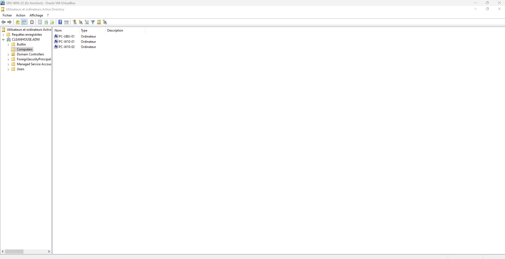
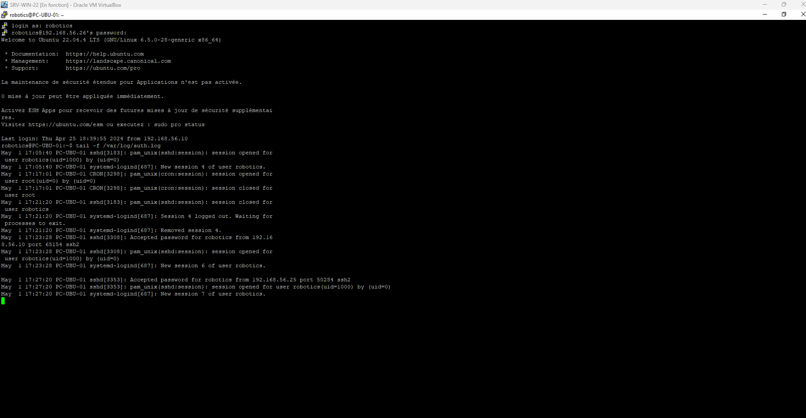

# 🚀 Déploiement du parc informatique d'une start-up

## 📋 Contexte du projet
Dans le cadre de ma formation de **Technicien Informatique** (OpenClassrooms), j'ai préparé et automatisé le déploiement des postes de travail (environnements **Windows** et **Linux**) pour les collaborateurs d'une start-up, en garantissant une configuration homogène, automatisée et prête à l'emploi.

---

## 🛠️ Compétences techniques mobilisées
* **Déploiement automatisé :** Création et utilisation d'un fichier de réponses sans assistance (`unattend.xml`) pour automatiser l'installation et le paramétrage système.
* **Administration multi-OS :** Déploiement et configuration de postes clients sous **Windows** et **Linux**.
* **Gestion de parc :** Intégration, nommage et vérification des machines déployées dans l'infrastructure.
* **Documentation technique :** Rédaction d'une procédure complète et reproductible pour l'équipe support.

---

## 📸 Aperçu des réalisations techniques

### Intégration et vérification des postes déployés

### Déploiement et configuration de l'environnement Linux

---

## 📂 Livrables complets du projet
* 📖 [Consulter la procédure complète de déploiement (PDF)](Hocine_Bachir_1_Procedure_052024.pdf)
* ⚙️ [Consulter le fichier de configuration automatisée (.xml)](Hocine_Bachir_2_XML_052024.xml)
